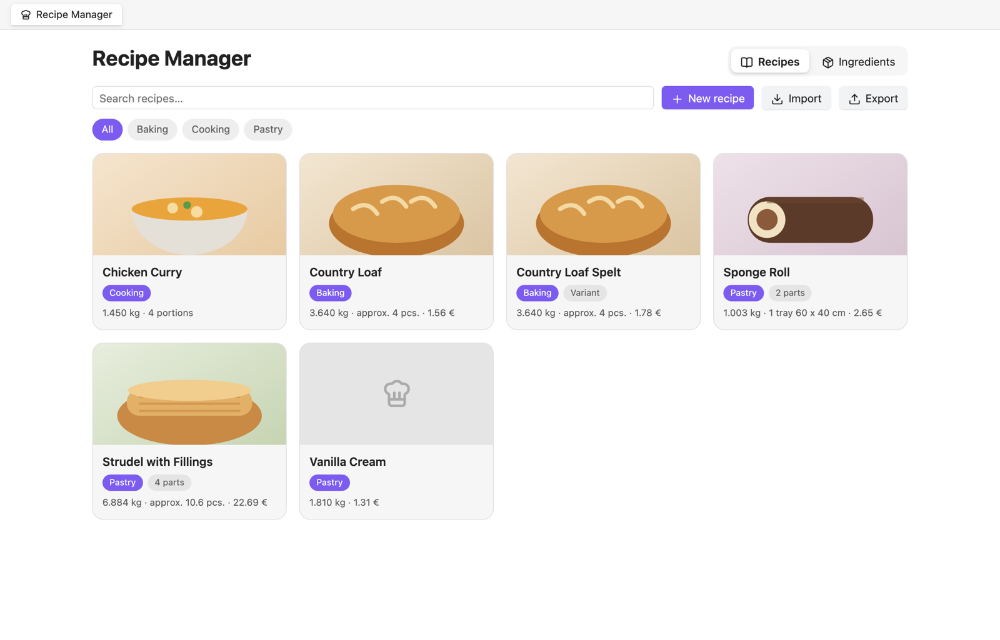
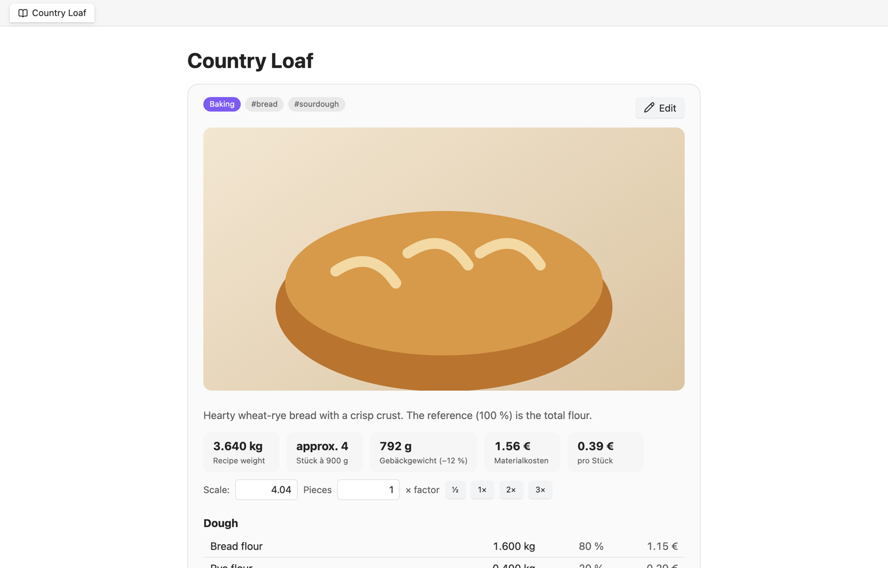
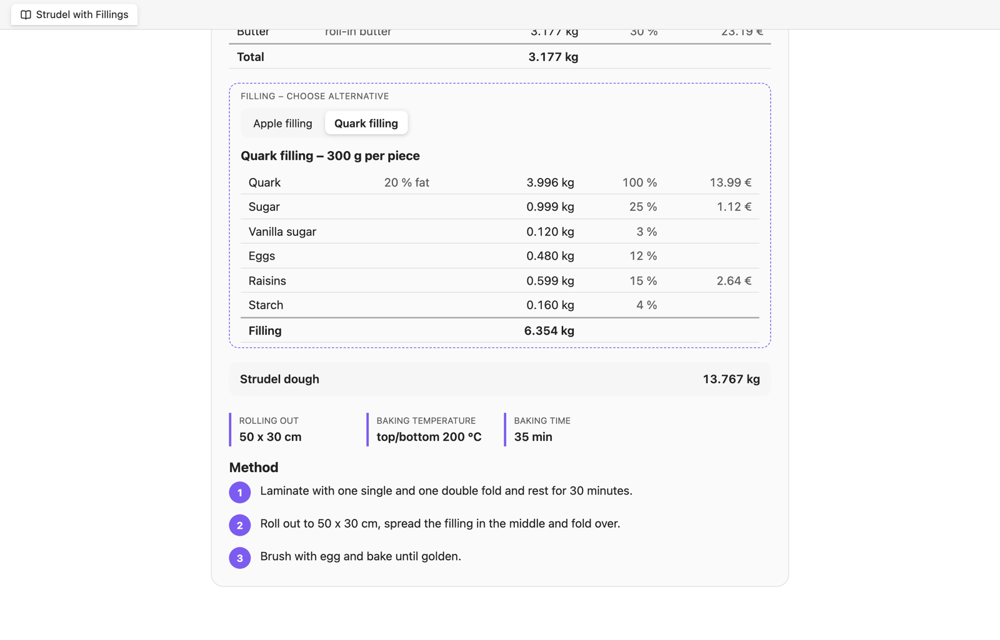
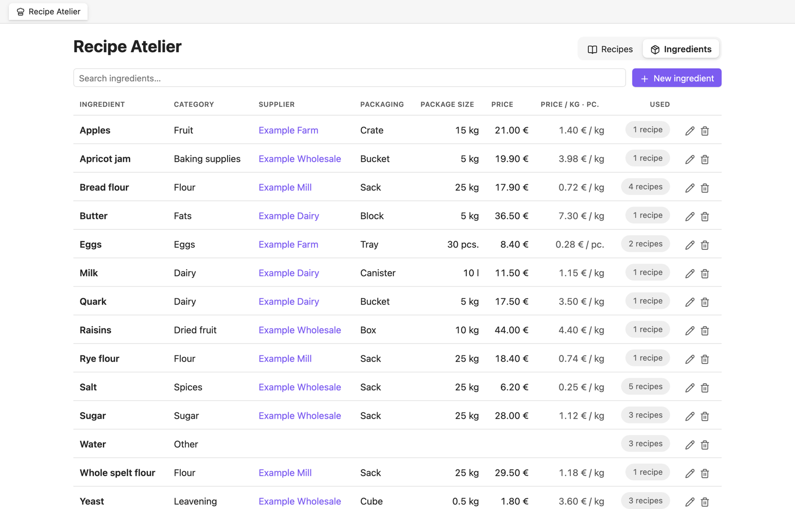
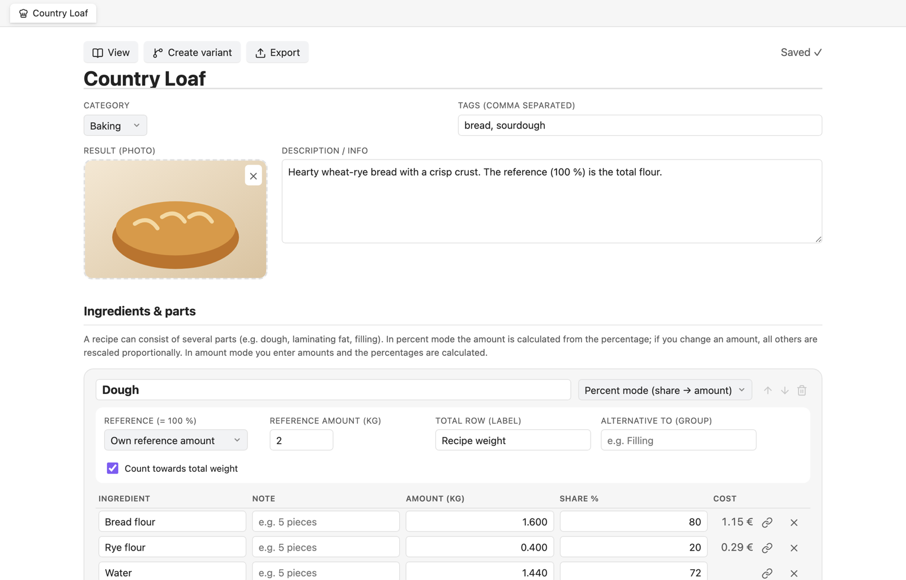
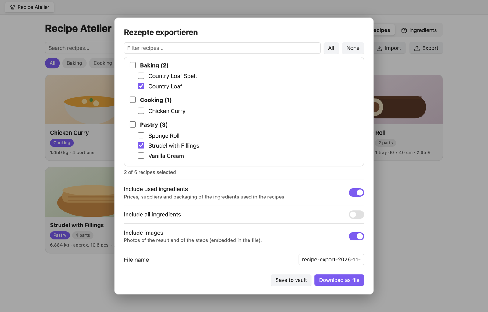
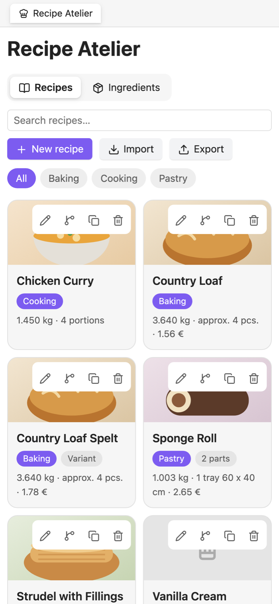
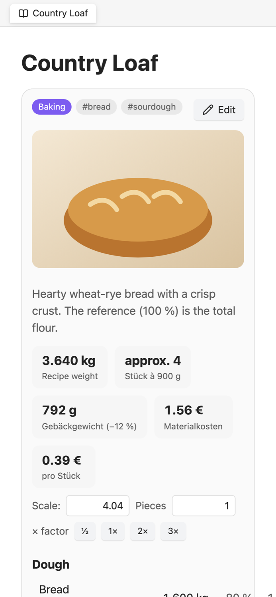
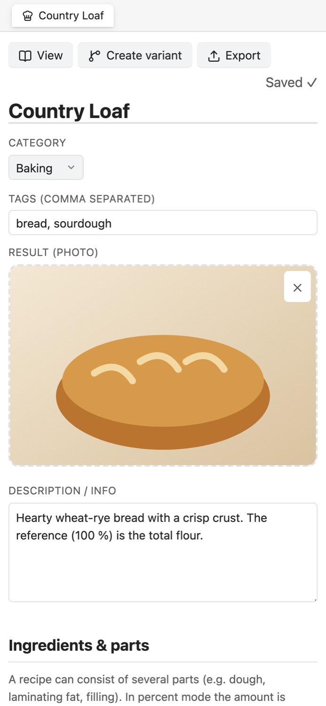

# Recipe Atelier

Recipe management for **baking, cooking and pastry** – with baker's percentages, multi-part recipes, piece / portion / tray scaling, an ingredient database with prices and suppliers, step photos, variants and a one-file export/import.

Recipes are normal notes in your vault, ingredients are normal notes with properties. Nothing is sent anywhere; the plugin works fully offline and on **desktop and mobile** (Windows, macOS, Linux, iPhone, iPad, Android).

> **Languages:** English and German (Deutsch). The interface follows the Obsidian language automatically and can be switched in the plugin settings.



## Features

### Recipes with several parts
- A recipe can consist of any number of **parts** (e.g. *dough*, *laminating fat*, *filling*, *glaze*, *sour dough*, *soaker*).
- **Percent mode (baker's percentages):** every ingredient has a percentage of a reference (one ingredient, a free base amount, or the total of another part). Amounts are calculated. Change any amount and the whole part is rescaled proportionally.
- **Amount mode:** type amounts in `g`, `kg`, `ml`, `l`, `pcs.`, `tbsp`, `tsp`, … and the percentages are calculated.
- **Linked parts:** an ingredient can point to the sum of another part (e.g. *Poolish* inside the final dough).
- Notes per ingredient (e.g. “5 pieces”, “room temperature”).



### Scaling
- **Pieces:** set a piece weight, then change the number of pieces – every amount follows. Optional baking loss gives the baked weight.
- **Portions** (cooking) and **trays** (e.g. 60 × 40 cm).
- **Filling per piece:** a part that is not part of the total weight can be driven by the piece count (e.g. 20 g filling per piece).
- In the recipe view you can scale *temporarily* with a factor or a target piece count without changing the recipe.



### Alternatives and variants
- **Alternatives:** parts with the same group name (e.g. *Filling*) are shown as tabs – pick one, the costs follow the selection.
- **Variants:** create a full copy of a recipe with one click. The variant keeps a link to its original.

### Ingredients and costs
- Ingredient database: category, supplier **with website link**, packaging unit, package weight, price per package, article number, allergens.
- **Fixed ingredient numbers:** renaming an ingredient updates all recipes; export/import keeps the links.
- **Piece weight** for converting pieces to grams (e.g. eggs), package units incl. m³.
- **Where used:** see in how many recipes an ingredient is used, sort by usage, and jump from an ingredient to its recipes.
- Price per kg / piece is calculated; recipes show **material cost** per recipe, per piece, per portion and per tray.



### Photos and steps
- Photo of the finished product, photo for every working step (file picker or drag & drop).
- Free-form parameters (dough temperature, proofing, baking temperature, baking time, program, …).



### Export and import
- Export **all or selected recipes** with the ingredients they use and their images into **one file** (`*.rmbundle.json`).
- Import with preview; existing recipes can be skipped, overwritten or imported as copies.



### Works everywhere
Light and dark themes, phone and tablet layouts, no Node/Electron APIs – so it runs on every Obsidian platform.

| Dashboard | Recipe | Editor |
|---|---|---|
|  |  |  |

## Installation

**From the community plugin browser** (after approval): *Settings → Community plugins → Browse → “Recipe Atelier” → Install → Enable*.

**Manual:** download `main.js`, `manifest.json` and `styles.css` from the [latest release](https://github.com/MarioLung/obsidian-recipe-atelier/releases/latest) and copy them to
`<your vault>/.obsidian/plugins/recipe-atelier/`, then enable the plugin under *Community plugins*.

**With BRAT** (beta testing, also works on iPhone/iPad): add this repository in the BRAT plugin.

## Getting started
1. Click the chef-hat icon in the ribbon (or run the command **Open dashboard**).
2. **New recipe** → title and category → the editor opens.
3. Add parts and ingredients. Choose the reference (“100 %”) for each part.
4. Optionally add ingredients in the **Ingredients** tab (price, package, supplier) – ingredients with the same name are linked automatically and costs appear.
5. Open the note to see the recipe card with scaling.

## How data is stored
- **Recipe:** a Markdown note in `<recipe folder>/<category>/`. Properties: `rm-type: recipe`, `category`, `tags`. The recipe itself is a fenced block ` ```recipe-manager ` containing JSON. Everything you write below the block stays untouched.
- **Ingredient:** a note in `<recipe folder>/Ingredients/` with properties `rm-type: ingredient`, `category`, `supplier`, `supplier-url`, `packaging`, `package-size`, `package-unit`, `price`, `article-number`, `allergens`, `notes`.
- **Images:** stored in the images folder (default `Recipes/Images`).

Because everything is plain notes, it works with Obsidian Sync, iCloud, Git, search, Bases and Dataview.

## Settings
Language, recipe folder, ingredient folder, image folder, weight unit in percent mode (kg or g), currency, cost display on/off, categories (each category gets its own sub-folder) and a button to sort existing recipes into category folders.

## Mobile notes
- All features work on phones and tablets.
- On iOS/iPadOS the browser-style download of an export file may be unavailable – use **Save to vault** and share the file from the Files app.

## Privacy
The plugin works **completely offline and without any account** (no sign-up, no subscription, no payment). It makes **no network requests**, has **no telemetry**, shows **no ads** and does not install or update anything by itself. It only reads and writes files inside your vault.

## Permissions and behavior

- **Only looks into two folders:** the configured recipe folder (including its sub-folders) and the ingredient folder. The plugin never enumerates the rest of your vault. Recipes and ingredients must therefore live in these folders (change them in the settings if needed).
- **Writes** only recipe and ingredient notes, images in the configured image folder, and (on request) an export file in `<recipe folder>/Export`.
- No network requests, no external processes, no telemetry.

## Support & contributions
Issues and pull requests are welcome – see [CONTRIBUTING.md](https://github.com/MarioLung/obsidian-recipe-atelier/blob/main/CONTRIBUTING.md).

## License
[MIT](https://github.com/MarioLung/obsidian-recipe-atelier/blob/main/LICENSE)
